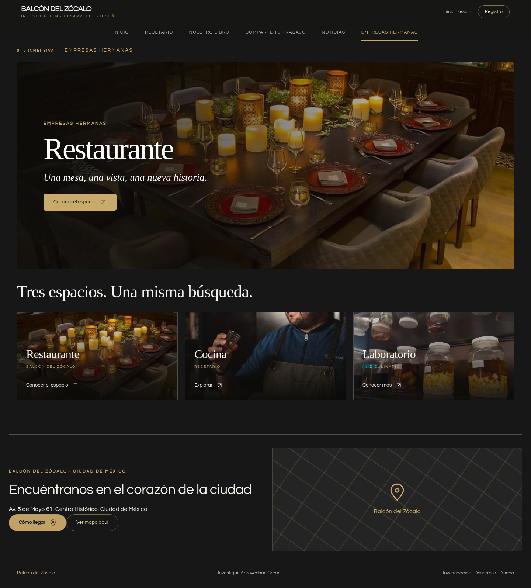
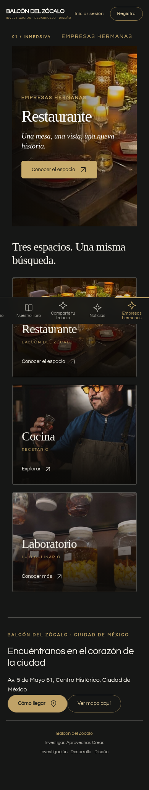

# Auditoría y reparación de Balcón del Zócalo

Fecha: 10 de noviembre de 2026, Ciudad de México. Base revisada: `a5a45d4` de `gh-pages`.

Actualización solicitada por el dueño: los carruseles se muestran sin franja inferior, indicadores numerados, contador ni botones. También se ocultan y colapsan los controles conservados en secciones y copias antiguas. Se mantienen el cambio automático, el teclado y el gesto horizontal.

Se revisaron el sitio, el editor de bloques, el editor visual, las plantillas, el guardado local, el cliente de publicación y los límites declarados en el SQL. Las reparaciones se verificaron en Chromium contra el código real de la aplicación. Los servicios de cuenta, biblioteca y publicación se simularon localmente: ninguna prueba escribió en la base de datos real.

## Hallazgos y correcciones

| Problema comprobado | Reparación |
| --- | --- |
| “Sin fondo ni borde” y los modos de fondo competían; no había un control independiente para el borde. | Fondo automático, transparente, cristal o sólido; borde automático, sin borde o visible. Ambos editores utilizan las mismas reglas. Los bloques antiguos con `plain` se pueden volver a configurar. |
| Un borde podía cambiar de color y seguir invisible porque su ancho o estilo seguían en cero. | “Mostrar borde” establece un borde real. Un fondo transparente puede conservar su borde. |
| El fondo de las diapositivas tapaba el fondo elegido para el bloque. Los grupos también tenían una regla de transparencia que ganaba al selector de fondo. | Las capas interiores respetan la superficie del bloque; los grupos admiten fondo y borde. Las imágenes y el contenido permanecen. |
| El editor visual podía conservar una modificación anterior que anulaba lo guardado después en el formulario del bloque. | Al guardar las propiedades del bloque se limpian las modificaciones equivalentes del contenedor. Se conservan las posiciones y las ediciones independientes de sus hijos. |
| Guardar un texto elegía la primera opción de selectores sin valor: por ejemplo, un banner centrado podía convertirse en una composición lateral. | Se incorpora “Automático” para conservar el ajuste, la ubicación y la alineación heredados. |
| El color requería activar una casilla adicional aunque el usuario ya hubiera elegido un color. | Elegir o escribir un color lo activa. Desactivar su casilla permite regresar al valor del tema. |
| El zoom solo se aplicaba en algunos contenedores. Los ajustes generales del carrusel podían perderse al guardar diapositivas sin valores propios. | Un único aplicador de ancho, alto, ajuste, foco y zoom sirve para imágenes, banners y diapositivas. Los campos vacíos de una diapositiva heredan el ajuste del carrusel. |
| Un alto fijo y el texto superpuesto podían recortar contenido o invadir los controles del carrusel. | El alto del módulo funciona como un mínimo; la composición crece con el texto. La franja de controles se eliminó según la preferencia posterior del dueño. |
| “Sin icono” podía conservar un SVG anterior o acumular otro icono. | La edición reemplaza o elimina el icono del elemento seleccionado. |
| Algunas opciones del formulario del grupo no tenían efecto sobre su contenido capturado. | El grupo ofrece sus propiedades aplicables: nombre, superficie y dimensiones. Su contenido se sigue editando seleccionando sus elementos. |
| Las copias visuales no incluían todos los nuevos atributos y estilos de superficie y carrusel. | Se conservan los atributos de fondo/borde, variables de color, dimensiones, zoom y controles en las capturas que utiliza el editor. |
| Los carruseles podían mezclar diapositivas anidadas y mostraban una franja que el dueño no quiere. | Carruseles sin franja ni controles visibles; cambio automático, flechas de teclado y gesto horizontal. Cada instancia controla exclusivamente sus propias diapositivas. La eliminación o el cambio de página libera eventos y temporizadores. |
| La barra móvil podía dejar el menú activo fuera de la parte visible. | La fila permite desplazamiento horizontal y centra el menú activo. Se conserva el acceso a todos los menús. |
| Los títulos de las páginas personalizadas figuraban como “Inicio” en la pestaña del navegador. | Se usa el título de la sección correspondiente. |
| Una sección creada vacía podía seguir ocultando su encabezado después de editarlo. | Editar su presentación habilita el encabezado. |
| El navegador admitía borradores de 20 MB pero `publish_site` limita el documento a 4 MB. Las imágenes en base64 podían romper la publicación aunque el borrador funcionara. | Antes de publicar se envían los originales incrustados a `site-media` y se sustituyen sus referencias por URL. Una imagen repetida se sube una sola vez por preparación. Se comprueba el tamaño UTF-8 del documento y el espacio de serialización de JSONB. |
| Un rechazo del servidor podía dejar imágenes ya cargadas sin reutilizar en el siguiente intento. | Las referencias preparadas se guardan en el borrador antes de publicar. Un rechazo conserva ese borrador; el reintento reutiliza los archivos. El error se explica sin anunciar éxito. |

No se necesita cambiar el SQL para esta solución: las fotos van a la biblioteca y el documento publicado respeta el límite del servidor existente. El límite de archivo de 30 MB permanece en el cliente y en el SQL de configuración.

## Plantilla de Empresas hermanas

La plantilla **Empresas hermanas · Inmersiva** sigue la referencia visual: portada fotográfica, texto superpuesto con tipografía serif, acentos dorados, carrusel sin franja inferior y tarjetas de espacios.

- Se reconoce la sección `section-fbc97490-7ba` y las páginas tituladas “Empresas hermanas”. En su primera normalización se prepara una portada superpuesta y se marca la plantilla, conservando sus bloques, textos, fotos y enlaces.
- También se puede elegir en “Editar borrador → Sección personalizada → Plantilla de la sección”, o al crear un menú nuevo.
- Cambiar después el carrusel a una presentación lateral funciona: la plantilla no fuerza nuevamente el modo superpuesto.
- La plantilla se puede desactivar eligiendo “Estándar”. Cambiar de plantilla conserva el contenido.
- El respaldo incluido muestra fotografías ya presentes en la aplicación. No inventa enlaces de reservación; los destinos de cada empresa se pueden configurar en sus botones.

Las capturas adjuntas muestran el **contenido de respaldo local**, no una lectura del contenido privado del servicio:

## Calidad de las imágenes

La aplicación mantiene los bytes del original al cargarlo y al convertir una imagen incrustada en un archivo de biblioteca. Los ajustes de recorte, proporción, foco y zoom se aplican igual en la vista pública y en el editor. El formulario muestra las dimensiones reales del archivo y una indicación cuando resulta pequeño para una portada grande.

Una foto cuya fuente ya tiene pocos píxeles no recupera detalle mediante CSS. Para una portada de pantalla completa conviene sustituir esas fuentes por originales de al menos 1920 px de ancho. Esta auditoría no generó fotografías ficticias de los establecimientos ni declaró haber recuperado detalle ausente en los originales.

## Verificación realizada

`tests/browser-audit.cjs` ejecuta **19 grupos de comprobaciones**. Incluyen:

- Las nueve rutas principales/de cuenta y la sección de empresas a 320, 390, 768, 1100 y 1440 px; sin desbordamiento horizontal de la página.
- Fondo y borde en los ocho tipos de bloque: banner, imagen, texto, título, botón, acceso directo, grupo y carrusel. También se prueba conservar el borde al quitar el fondo.
- Recuperación de bloques antiguos, guardado y reapertura de borradores en IndexedDB.
- Ancho, alto, proporción, foco y zoom de imagen; textos largos sin invasión de los controles.
- Edición visual de texto, tamaño, alineación, color, fondo, borde e icono.
- Rechazo de enlaces inválidos dentro del diálogo, conservando el documento anterior.
- Selección y creación de la plantilla, creación/eliminación de un botón y conservación de contenido al cambiar de plantilla.
- Carga de archivos conservando su tamaño original; preparación de un PNG real de más de 4 MB; deduplicación de referencias y límites UTF-8.
- Carruseles anidados, controles ausentes y desconexión de eventos al desmontar.
- Error de publicación, conservación del borrador, reintento sin repetir cargas y lectura del resultado en un contexto de visitante nuevo.
- Ausencia de errores de JavaScript sin capturar durante las comprobaciones.

También pasan la comprobación de sintaxis de los scripts y `git diff --check`. Las instrucciones reproducibles están en [tests/README.md](tests/README.md).

## Alcance de la verificación remota

La política de red del entorno bloqueó el acceso HTTP a `adolfoacr.github.io` y al servicio de Supabase. Se pudo obtener y modificar el repositorio mediante GitHub. No se utilizó una sesión real de administrador de Supabase.

Por eso, las pruebas del contenido actualmente almacenado, sus archivos externos, los permisos efectivos de la base de datos, los correos de autenticación y la publicación autenticada real quedan pendientes de una sesión conectada. El funcionamiento local y las respuestas simuladas no demuestran el estado de esos servicios. El despliegue de los archivos estáticos se verifica por separado mediante GitHub Pages.
